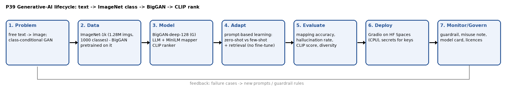
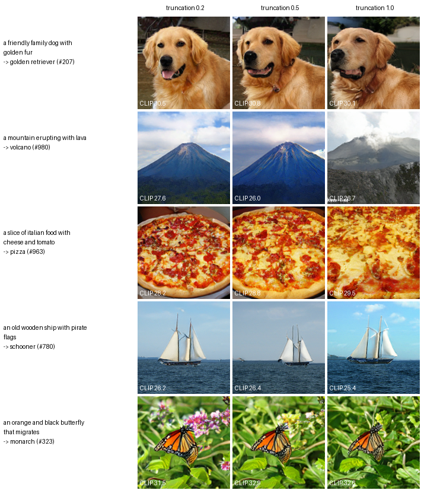

# P39 · Class-Conditional Image Studio (BigGAN)

**Goal:** generate images from free text via the nearest ImageNet class.

- **Live app:** https://p39-biggan-studio-2yj4yrxzre63hg8dhuqdkt.streamlit.app/
- **Report:** [report/P39_Report.pdf](report/P39_Report.pdf) · **Demo video:** submitted as P39_Demo_Video.mp4 (intro: [video/brag-output/brag.mp4](video/brag-output/brag.mp4))



## Pipeline
```
text ─► guardrail ─► LLM guesses names ─► MiniLM candidates ─► LLM few-shot picks class ─► BigGAN-deep-128 (truncation ψ)
                                                                                  │
                                         ranked gallery ◄── CLIP score vs text ◄──┘
```

| Unit | What is implemented | Where |
|---|---|---|
| U1 Foundations | truncation as sampling a narrower distribution; generative vs discriminative; zero-shot vs few-shot prompts; lifecycle diagram | `docs/about.md`, `studio/biggan_gen.py`, `docs/lifecycle.png` |
| U2 GANs & LLMs | LLM maps text → class; pretrained BigGAN generates; attention / conditional-BN explanation; LLM vs embedding comparison | `studio/mapper.py`, `eval/run_mapping_eval.py` |
| U3 GPT, BERT & multimodal | GPT-style LLM + BERT-family MiniLM + CLIP ranking; diffusion comparison | `studio/clip_rank.py`, `eval/compare_diffusion.py` |
| U4 Tools & generation | PyTorch truncation slider + grid explorer; 5 prompts × 3 truncations grid | `app.py`, `eval/make_grid.py` |
| U5 Responsible AI | guardrail, misuse note, class-imbalance / people-bias probe, hallucination rate, licences, model card | `studio/guardrail.py`, `MODEL_CARD.md` |

## Results

### 5 prompts × 3 truncation values


<!-- RESULTS:START -->
### Text → class mapping (30 labelled prompts)
| Method | Top-1 accuracy | Hallucination rate | LLM errors | Mean latency |
|---|---|---|---|---|
| embedding | 47% (14/30) | 0% | 0 | 16 ms |
| llm_zero | 90% (27/30) | 27% | 0 | 874 ms |
| llm_fewshot_v1 | 87% (26/30) | 3% | 0 | 3144 ms |
| llm_fewshot | 93% (28/30) | 0% | 0 | 6441 ms |

### Truncation trade-off
| Prompt | Class | CLIP @ 0.2 | CLIP @ 0.5 | CLIP @ 1.0 | Div @ 0.2 | Div @ 0.5 | Div @ 1.0 |
|---|---|---|---|---|---|---|---|
| a friendly family dog with golden fur | golden retriever | 29.6 | 29.4 | 29.1 | 0.025 | 0.049 | 0.084 |
| a mountain erupting with lava | volcano | 26.8 | 26.0 | 26.0 | 0.021 | 0.063 | 0.145 |
| a slice of italian food with cheese and tomato | pizza | 27.7 | 27.7 | 27.7 | 0.029 | 0.043 | 0.093 |
| an old wooden ship with pirate flags | schooner | 26.5 | 26.8 | 26.4 | 0.028 | 0.045 | 0.108 |
| an orange and black butterfly that migrates | monarch | 31.2 | 30.6 | 30.6 | 0.013 | 0.026 | 0.076 |
| **Mean** | | **28.4** | **28.1** | **28.0** | **0.023** | **0.045** | **0.101** |

### BigGAN vs diffusion (CLIP score against the free text)
| Prompt | BigGAN class | BigGAN CLIP | sd-turbo CLIP | BigGAN time | sd-turbo time |
|---|---|---|---|---|---|
| a friendly family dog with golden fur | golden retriever | 29.7 | 30.1 | 8.6 s* | 35.2 s |
| a mountain erupting with lava | volcano | 28.5 | 30.7 | 1.8 s | 35.5 s |
| a slice of italian food with cheese and tomato | pizza | 28.5 | 30.6 | 1.8 s | 37.9 s |
| an orange and black butterfly that migrates | monarch | 31.6 | 33.4 | 2.0 s | 36.1 s |
| a cat riding a bicycle | bicycle-built-for-two | 24.3 | 36.1 | 1.9 s | 35.1 s |
| **Mean** | | **28.5** | **32.2** | | |

Full tables, error lists, out-of-vocabulary and people-bias probes: [`results/`](results/).
<!-- RESULTS:END -->

### Iteration: before/after query expansion
Few-shot v1 failed only when the right class was missing from the encoder's top 20 (e.g. "the king of the jungle roaring" → tiger, "an orange and black butterfly" → sulphur butterfly). Adding LLM query expansion (v2) raised accuracy from 87% to **93–97%** (28/30 and 29/30 in two runs; results vary slightly between runs) with no invalid answers, at the cost of a second LLM call.

### Failure cases
"a sour green apple" is still mapped to **lemon** instead of **Granny Smith** by v2, and in one run "a stringed instrument played with a bow under the chin" became **cello** instead of violin. The embedding baseline maps "an orange and black butterfly that migrates" to **sulphur butterfly** (yellow) instead of **monarch**: the encoder matches the word "butterfly" but ignores the colours. Out-of-vocabulary prompts such as "a giraffe at sunset" (giraffe is not an ImageNet-1k class) or "a cat riding a bicycle" are forced onto a single class. The app shows a low-confidence warning when no ImageNet label is close to the text (best encoder similarity below 0.35, e.g. "freedom").

## Run locally
```bash
python -m venv .venv && .venv/Scripts/activate      # Windows (use bin/activate on Linux/macOS)
pip install -r requirements.txt
set GROQ_API_KEY=...        # optional; without a key the embedding mapper is used
python app.py
```
BigGAN weights (211 MB) download automatically on first run from the official `pytorch-pretrained-biggan` bucket and are loaded with `torch.load(weights_only=True)`.

Evaluation:
```bash
python eval/run_mapping_eval.py          # mapping accuracy / hallucination / bias probe
python eval/make_grid.py                 # 5×3 grid + truncation table
pip install diffusers accelerate
python eval/compare_diffusion.py         # BigGAN vs sd-turbo CLIP comparison
```

## Deploy (Streamlit Community Cloud, live app)
1. Sign in at [share.streamlit.io](https://share.streamlit.io) with GitHub, then click **Create app → Deploy a public app from GitHub**.
2. Repository `shreyanshu1966/p39-biggan-studio`, branch `main`, main file **`streamlit_app.py`**. Under **Advanced settings** pick Python 3.12 and add the secret `GROQ_API_KEY = "..."`. Never commit keys.
3. The first boot installs `requirements.txt` and downloads BigGAN, CLIP and MiniLM (a few minutes).

`app.py` is the same app in Gradio, for local use or a Hugging Face Space (Gradio Spaces need HF PRO).

## Ethics
See the *About · Ethics · Results* tab ([docs/about.md](docs/about.md)) and [MODEL_CARD.md](MODEL_CARD.md). For education and research only. ImageNet is licensed for non-commercial use.
